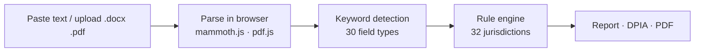

# Compliance Checkup

**Cross-border recruitment data compliance checker · 32 jurisdictions · 7 languages**

🔗 Live: https://compliance-checker.hengruihope.workers.dev

Paste a job application form, offer template or field list (or upload Word/PDF files). The tool detects which personal data fields are collected and classifies each one per target market — **Allowed / Use caution / Restricted (sensitive) / Prohibited / No specific law** — with the legal basis cited. It can generate a DPIA draft (web preview + Word download) and export a watermarked PDF report.

> Informal compliance tool based on publicly available regulatory information. Not legal advice.

---

## Highlights

| | |
|---|---|
| **Coverage** | 32 jurisdictions in 10 regions, 30 field types |
| **Languages** | 简体中文 · 繁體中文（香港）· English · Tiếng Việt · Bahasa Indonesia · 日本語 · العربية (RTL) |
| **Privacy** | Documents are parsed entirely in the browser; nothing is sent to a server |
| **Transparency** | Every jurisdiction is graded by verification depth (4 tiers), shown in the methodology panel |
| **Outputs** | Per-field recommendations, DPIA draft (.doc), watermarked PDF |

## How it works



- **Detection:** keyword matching (≈8–15 Chinese/English expressions per field); fields can also be added manually or as custom fields
- **Classification:** each market is either verified field by field, follows the EU GDPR text directly, uses a verified local rule set, or is marked as having no dedicated law
- **i18n:** internal identifiers stay fixed; text is translated only at display time, so translation never touches the rule logic

## Repository structure

```
public/index.html      # the entire app (single self-contained page)
wrangler.jsonc         # Cloudflare deployment config — publishes public/ only
CHANGELOG.md           # version history
README.md              # this file
```

## Deployment

Hosted on Cloudflare Workers (static assets). Every `git push` to `main` triggers an automatic build and deploy.

```bash
git add .
git commit -m "describe the change"
git push
```

Rollback: `git revert HEAD && git push`

## Version history (summary)

| Version | Milestone |
|---|---|
| v1.0 | Manual field checklist |
| v2.x | Automatic detection from pasted text / uploaded files; 32 jurisdictions grouped by region; PDF export with watermark; batch upload; manual and custom fields |
| v3.0–3.2 | DPIA draft generation (GDPR Art. 35(7), ICO/EDPB structure) with Word download |
| v3.3–3.6 | Jurisdiction-by-jurisdiction legal verification; honest four-tier grading |
| v3.7 | Pre-launch security review (XSS fix), changelog moved out of public HTML, signature |
| v3.8 | First production deployment; content consistency fixes |
| v4.0 | i18n framework; full Simplified Chinese & English |
| v4.1 | Traditional Chinese (HK), Vietnamese, Indonesian, Japanese, Arabic (RTL) |

See `CHANGELOG.md` for details.

## Known limitations

- Keyword detection, not semantic understanding — unusual wording may be missed
- Materials in languages other than Chinese and English are not yet detected (the interface is translated; the keyword library is not)
- Scanned PDFs without a text layer are not supported
- Russia, Myanmar and Laos are classification estimates pending item-by-item verification
- Translations of legal terms should be reviewed by native speakers or local counsel before formal client use

## Author

Designed & built by **Henry Hu**
